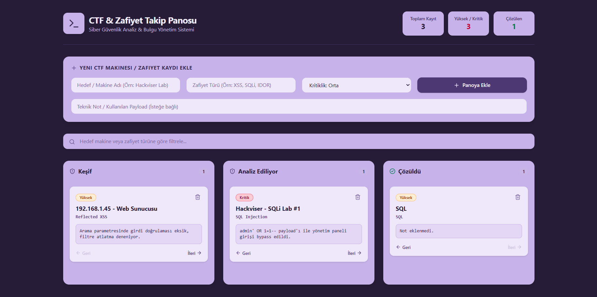

# 🛡️ CTF & Zafiyet Takip Panosu (Vulnerability & CTF Tracker)

Siber güvenlik çalışmaları, CTF (Capture The Flag) makine çözümleri ve sızma testi bulgularını organize etmek amacıyla geliştirilmiş, Kanban tabanlı web uygulamasıdır.

## 📸 Ekran Görüntüsü



## 🚀 Özellikler

- **3 Aşamalı Kanban Takibi:** Bulguları *Keşif*, *Analiz Ediliyor* ve *Çözüldü* aşamaları arasında tek tıkla taşıma.
- **Kritiklik Seviyesi:** *Düşük*, *Orta*, *Yüksek* ve *Kritik* seviyelerine göre renk kodlu risk rozetleri.
- **Canlı İstatistik Özeti:** Toplam kayıt, yüksek/kritik bulgu sayısı ve çözülen hedef sayısının anlık takibi.
- **Anlık Arama & Filtreleme:** Hedef makine adına veya zafiyet türüne (SQLi, XSS, IDOR vb.) göre hızlı filtreleme.
- **Kalıcı Yerel Depolama (`LocalStorage`):** Sayfa yenilense veya tarayıcı kapatılsa dahi verilerin tarayıcı hafızasında saklanması.

## 🛠️ Kullanılan Teknolojiler

- **Frontend:** React (Vite)
- **Stil & Tasarım:** Tailwind CSS (Özel Koyu Pastel Mor Tema)
- **İkon Seti:** Lucide React
- **Veri Saklama:** Web Storage API (`LocalStorage`)
- **Yayınlama (Deploy):** Netlify

## 🤖 Yapay Zeka Kullanım Süreci

Bu projenin geliştirme sürecinde **Gemini** yapay zeka asistanından aktif olarak yararlanılmıştır:
1. **Planlama ve Veri Modeli:** Siber güvenlik odaklı Kanban mimarisi ve kart veri modeli planlanmıştır.
2. **Bileşen ve Arayüz Geliştirme:** React state yönetimi (`useState`, `useEffect`), `LocalStorage` senkronizasyonu ve özel pastel mor renk paletiyle Tailwind CSS bileşenleri kodlanmıştır.
3. **Hata Ayıklama:** Geliştirme ortamı kurulumundaki PowerShell `ExecutionPolicy` ve Vite yapılandırma sorunları çözülmüştür.
4. **Dokümantasyon:** Kurulum ve proje detaylarını içeren `README.md` dokümanı oluşturulmuştur.

## 💻 Kurulum ve Yerelde Çalıştırma

```bash
git clone [https://github.com/b3rrak/ctf-tracker.git](https://github.com/b3rrak/ctf-tracker.git)
cd ctf-tracker
npm install
npm run dev